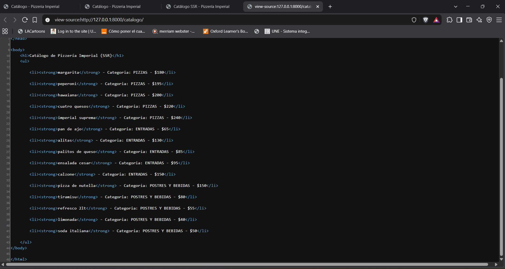
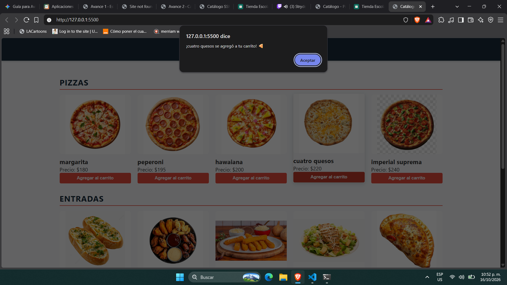

# Pizzería Imperial — PWA de ventas

| Dato | Valor |
|---|---|
| **Alumno** | IMPERIAL SILVA JOSE EDUARDO |
| **Grupo** | ING10-1 |
| **Negocio y giro** | Pizzería Imperial — Pizzería |
| **URL del repositorio** | https://github.com/joseimperials/Pizzeria-Imperial-pwa_imperial-silva-jose-eduardo |
| **URL de GitHub Pages** | https://joseimperials.github.io/Pizzeria-Imperial-pwa_imperial-silva-jose-eduardo/ |

## Historial de avances
| Avance | Hash del commit entregado | Fecha |
|---|---|---|
| 1 | `a569dae` | 11/10/2026 |
| 2 | `56a557d`  | 16/10/2026 |
| 3 | `a60f2e9`  | 17/10/2026 |
| 4 | `2928345` | 18/10/2026 |
| 5 | Se registra en el reporte PDF | 01/11/2026 |

## Comparación SSR vs CSR

### SSR (Django): los productos llegan escritos en el HTML

### CSR (JavaScript): el catálogo se genera en el navegador

