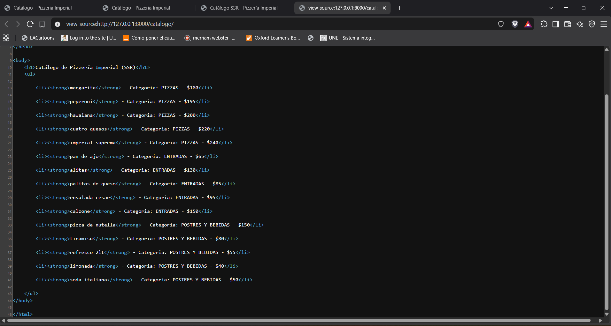
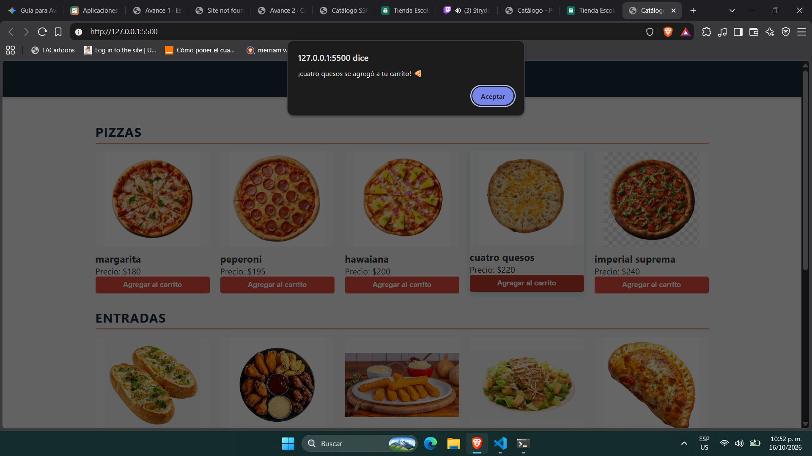
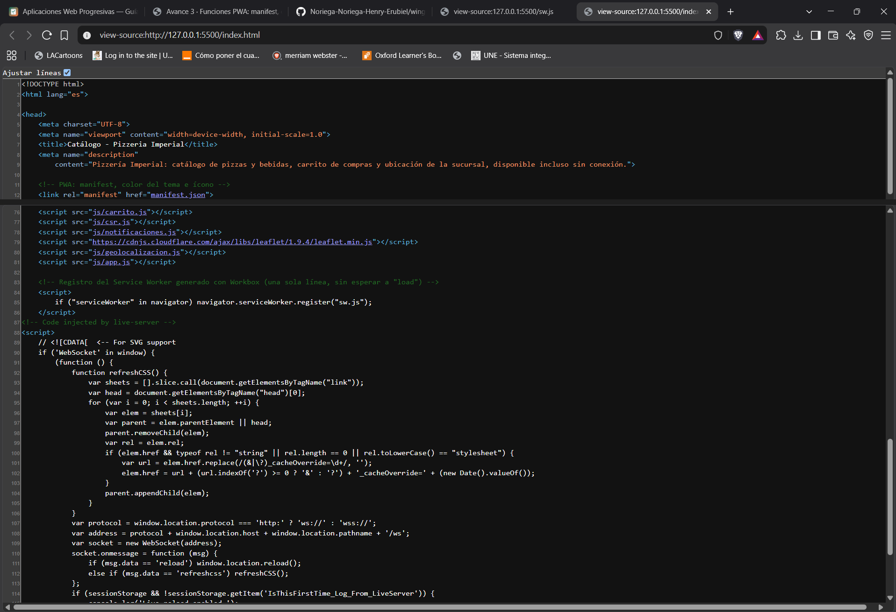
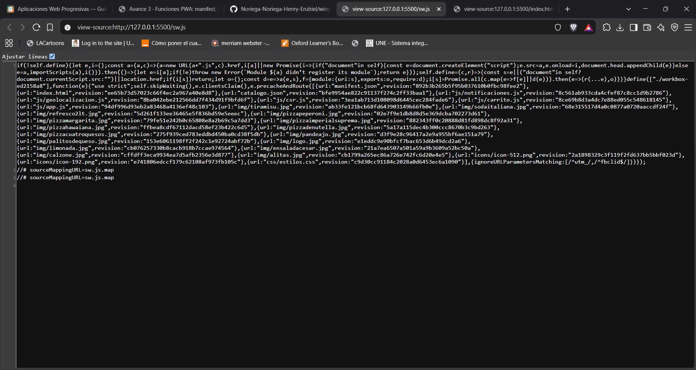
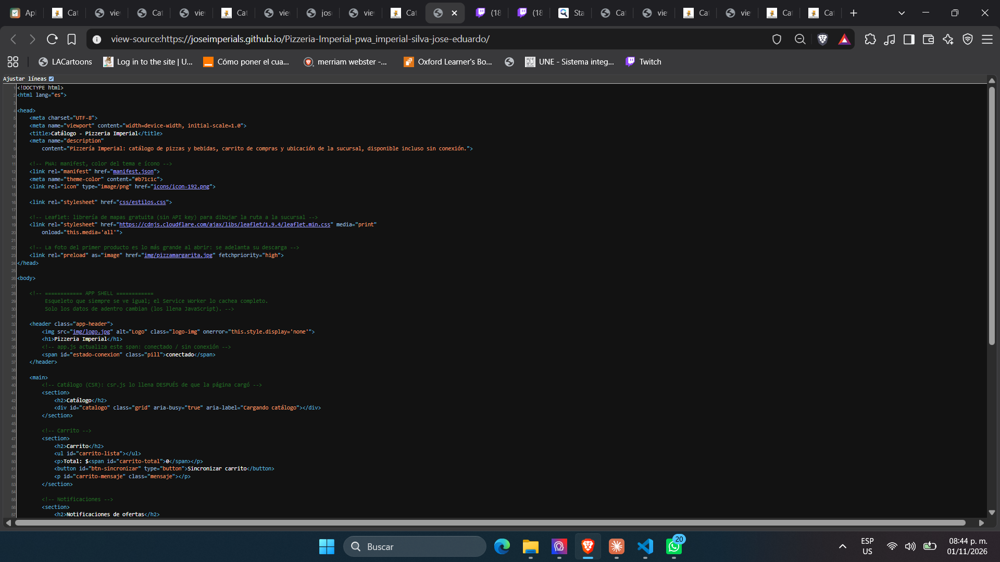
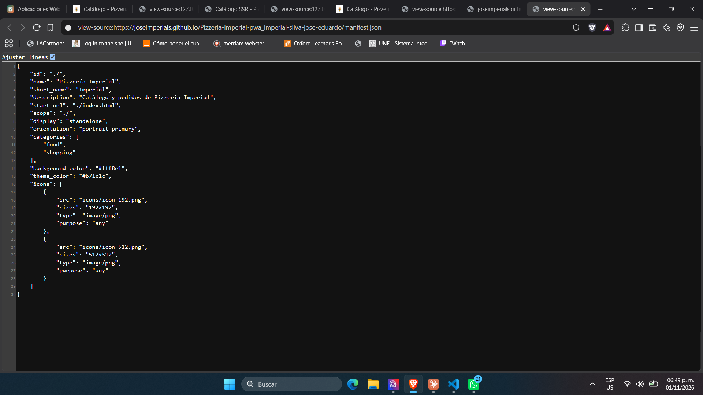
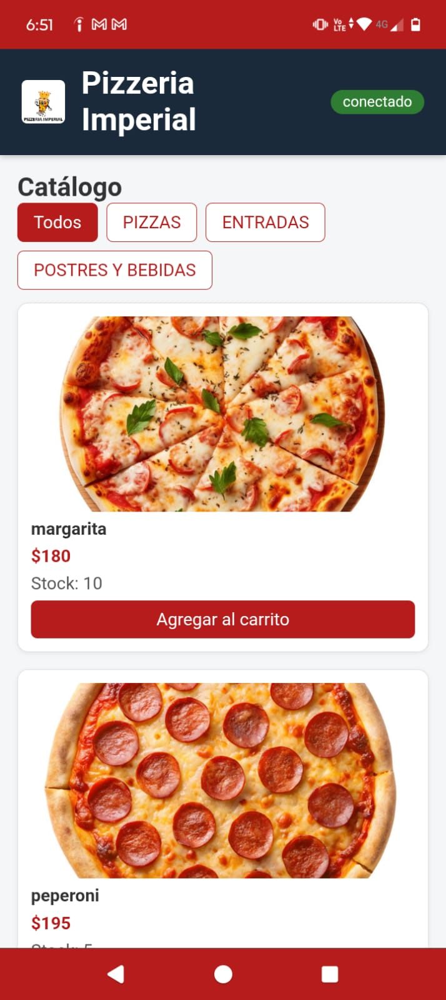

# Pizzería Imperial — PWA de ventas

| Dato | Valor |
|---|---|
| **Alumno** | IMPERIAL SILVA JOSE EDUARDO |
| **Grupo** | ING10-1 |
| **Negocio y giro** | Pizzería Imperial — Pizzería |
| **URL del repositorio** | https://github.com/joseimperials/Pizzeria-Imperial-pwa_imperial-silva-jose-eduardo |
| **URL de GitHub Pages** | https://joseimperials.github.io/Pizzeria-Imperial-pwa_imperial-silva-jose-eduardo/ |

## Historial de avances
| Avance | Hash del commit entregado | Fecha |
|---|---|---|
| 1 | `a569dae` | 11/10/2026 |
| 2 | `56a557d` | 16/10/2026 |
| 3 | `028c0ce` | 25/10/2026 |
| 4 | Se registra en el reporte PDF | 01/11/2026 |

## Comparación SSR vs CSR

### SSR (Django): los productos llegan escritos en el HTML

### CSR (JavaScript): el catálogo se genera en el navegador

## Funciones PWA (avance 3)

### index.html: manifest y registro del Service Worker activos

### sw.js: Workbox precachea el catálogo y las fotos

## Versión publicada (avance 4)

### index.html en GitHub Pages

### manifest.json en GitHub Pages

### Mi app instalada en el celular

## Guía de instalación

### 1-Abrir
URL para abrir la pagina web: https://joseimperials.github.io/Pizzeria-Imperial-pwa_imperial-silva-jose-eduardo/

### 2-Instalar
Para hacer la instalacion en Android: ingresa a la URL, en la parte inferior derecha del navegador aparecen 3 puntos en forma vertical,
lo pulsamos y abrira una lista de opciones, selecciona instalar y crear acceso directo, la aplicacion se abre desde el icono y sin la barra del navegador

### 3-Usar
Para usar la app: el catalogo aparece abajo del logo y nombre de la aplicacion, las categorias vienen por botones que al pulsarlos te filtra, muestra solo esa categoria y oculta las demas, para usar el carrito, pulsamos el boton agregar al carrito del producto que sea, el carrito se muestra casi al final de la aplicacion hasta abajo, y te muestra lo que agregaste y viene con los botones - y + entre esos botones aparce la cantidad de veces que se pidio un producto, a la derecha te muestra el total de ese producto, el total general aparece abajo y tambien aparece un boton que te da la opcion de quitar el producto hasta la derecha del carrito

### 4-Sincronizar
El boton sincronizar carrito, hace que se agreguen los productos que fueron seleccionados cuando no tenia conexion

### 5-Notificaciones
el boton de activar notificaciones, le das permitir al permiso y listo la aplicacion te avisara cuando se agregue algo al carrito

### 6-Distancia a sucursal
para ver la ruta pulsas el boton usar mi ubicacion para ver la ruta hacia el lugar fisico del local